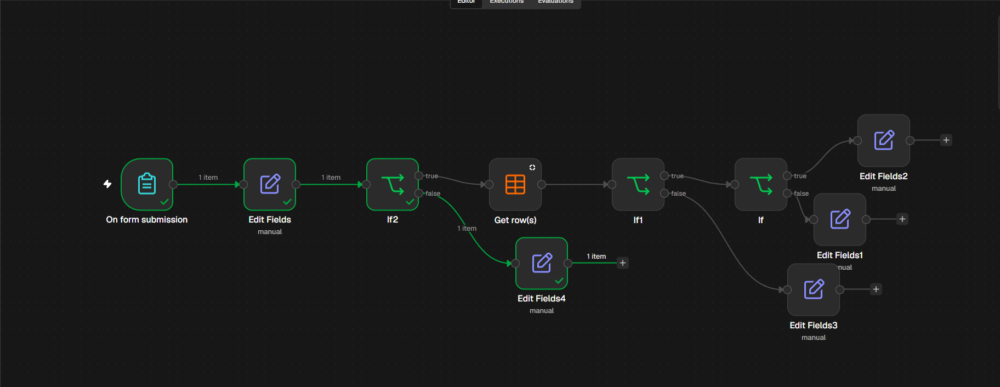
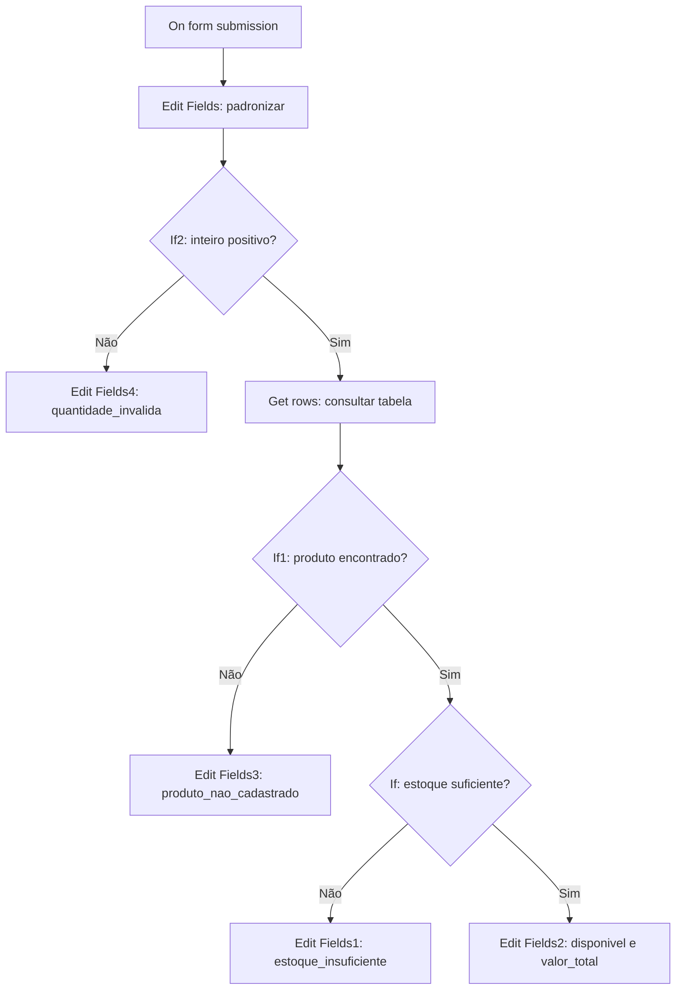

# Hefesius AI — Automação de pedidos em n8n

## Visão geral do workflow



> **Protótipo de estudo com dados fictícios.** Este repositório demonstra automação comercial low-code; **não é um agente de IA**, não tem consulta ao estoque de fornecedores em tempo real, não efetua pagamentos e não envia mensagens automaticamente aos clientes.

## O problema

Uma solicitação comercial precisa ser recebida, validada e confrontada com dados estruturados antes que alguém forneça uma resposta. A proposta deste laboratório é mostrar esse processo usando um formulário e uma tabela de demonstração.

## Tecnologias e competências

- **n8n:** Form Trigger, Edit Fields (Set), If, Data Table e Manual Trigger.
- **Expressões JavaScript:** validação numérica, acesso a nodes anteriores, comparações, multiplicação e formatação monetária em `pt-BR`.
- **Dados CSV:** catálogo fictício separado dos workflows.
- **Regras de negócio:** quatro status distintos, com respostas estruturadas.

## Estrutura do repositório

```text
HEFESIUS_AI_GitHub/
├── README.md
├── workflows/
│   ├── 01_verificador_estoque.json
│   └── 02_formulario_pedidos.json
├── dados/
│   └── produtos_exemplo.csv
├── docs/
│   ├── TESTES.md
│   └── SEGURANCA_E_LIMITACOES.md
└── .gitignore
```

## Fluxos

### 01 — Verificador de estoque (5 nodes)

Exercício introdutório que começa manualmente, define um pedido fictício, compara `estoque >= quantidade_desejada` e produz status de disponível/indisponível. Quando aplicável, calcula `valor_total`.

### 02 — Formulário de pedidos (10 nodes)



**Quatro status de saída:**

| Status | Regra aplicada | Exemplo |
|---|---|---|
| `quantidade_invalida` | Não é inteiro positivo | 0, -3, 1.5 |
| `produto_nao_cadastrado` | Não aparece na Data Table | iPhone 17 no CSV de exemplo |
| `estoque_insuficiente` | Estoque menor que quantidade | iPhone 13, 5 unidades |
| `disponivel` | Estoque maior ou igual à quantidade | iPhone 13, 2 unidades |

Na situação disponível, a expressão produz `valor_total` como número e a mensagem apresenta a moeda no formato `R$ 4.400,00` no exemplo de duas unidades do iPhone 13.

## Executar na sua própria instância n8n

1. Use uma instância do n8n com nodes **Form Trigger** e **Data Table**.
2. No n8n, crie uma tabela chamada **`hefesius_produtos`**: em *Data tables*, escolha **Create Data table → Import CSV** e use `dados/produtos_exemplo.csv`. Confirme que `produto` está como texto e `estoque` e `preco_unitario` como números.
3. No editor de workflows, use **Import from File** para carregar cada JSON de `workflows/`.
4. **Passo obrigatório:** no Workflow 02, abra **Get row(s)** e selecione manualmente a tabela `hefesius_produtos` recém-criada. O ID original da instância foi removido para fins de publicação.
5. Confira todas as configurações dos nodes, em particular o **Form Trigger** e a tabela. Inicie uma execução de teste e envie o formulário.
6. Compare o caminho percorrido com os exemplos em [`docs/TESTES.md`](docs/TESTES.md).

> Os JSONs são exemplos importáveis em princípio, mas **não foram reimportados e executados em uma segunda instância** durante a preparação deste pacote. Podem exigir seleção da tabela e ajustes de compatibilidade de versão.

## Como foi corrigida a entrada

O node **Edit Fields** do segundo workflow faz a conversão:

```js
Number.isFinite(Number($json["Quantidade Desejada"]))
  ? Number($json["Quantidade Desejada"])
  : 0
```

Em seguida, o **If2** aceita somente `Number.isInteger(quantidade_desejada) && quantidade_desejada >= 1`. A substituição por zero evita `NaN` na atribuição numérica, mas **não é uma estratégia perfeita de validação de dados brutos** (por exemplo, certos valores vazios podem converter para 0). Essa situação deverá ser refinada em versões futuras.

## Limitações

- Os valores de estoque e preço são **apenas exemplos fictícios**; a palavra `disponivel` se refere somente aos registros de demonstração, não a uma promessa comercial.
- As mensagens são geradas no **output interno do n8n**; o usuário do formulário vê a confirmação padrão de envio, não necessariamente a resposta construída.
- O sistema não reserva, atualiza nem baixa estoque, não autentica clientes, não registra pagamentos e não acessa fornecedores.
- Não há LLM, prompt, agente de IA ou integração de WhatsApp nesta etapa.
- Há limite de **um registro por produto** no node de consulta; evitar duplicatas na tabela.
- Os fluxos foram desenhados para **um pedido por submissão**; expressões `.item` e `.first()` exigem revisão antes de processamento em lote.
- O tratamento de falhas técnicas, controle de acesso e publicação do formulário ainda requerem trabalho adicional.

## Testes e evolução

Testes manuais relatados durante o desenvolvimento estão em [`docs/TESTES.md`](docs/TESTES.md). Próximas etapas: teste de importação em instância limpa, revisão de mensagens, registro dos pedidos, confirmação humana de cotação com fornecedor e só então estudo de integrações reais.

## Segurança

Este repositório contém uma **versão pública preparada**: identificadores internos originais de workflow, nodes, formulário, instância e tabela foram removidos ou substituídos. Não publique seus JSONs de backup diretamente. Verifique sempre os arquivos antes de enviar ao GitHub.

**Status:** demonstração educacional/portfólio; não usar como operação de vendas em produção.
